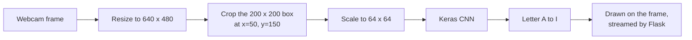

# ASL Sign Language Recognition

Hold up a hand sign in front of your webcam and the page shows the letter it recognises. A Keras CNN classifies the signs **A to I**, and a Flask app streams the camera with the prediction drawn on top.

Project title: *Real-Time Communication System Powered by AI for the Specially Abled*

---

## Quick start

**1. Get the model.** The trained model is not in the repo. Download it and put `asl_model.h5` into the `flask/` folder.

| File | Link |
| --- | --- |
| Model (`asl_model.h5`) | [Google Drive](https://drive.google.com/file/d/1NXq2WwmVUzNBdw3jI3yyYkK6GNv-y_AO/view?usp=drivesdk) |
| Dataset (only needed to retrain) | [Google Drive](https://drive.google.com/drive/folders/1e8J-mUzHhPs394yFUMEDLaqbMBNemEKD) |

**2. Install and run.**

```sh
pip install -r requirements.txt
cd flask
python app.py
```

**3. Open** <http://127.0.0.1:5000>, continue to the live page and allow camera access. Hold your sign inside the fixed box on the video.

---

## How it works



The app runs the model on every frame it sends. The crop is saved to `flask/image.jpg` before prediction (the file is git-ignored).

## Model

| | |
| --- | --- |
| Input | 64 x 64 RGB image |
| Layers | Conv2D (32 filters, 3 x 3) → MaxPool (2 x 2) → Flatten → Dense 300 → Dense 150 → Dense 9 (softmax) |
| Loss and optimizer | Categorical cross-entropy, Adam |
| Training | 10 epochs, batch size 900 |
| Augmentation | Rescale 1/255, zoom 0.2, horizontal flip |
| Classes | A, B, C, D, E, F, G, H, I |

The last cell of `notebooks/train.ipynb` carries the note *"Current accuracy is 0.863"*. That is the author's note in the notebook, not a result reproduced for this README.

> [!WARNING]
> **Known limits**
> - Only the letters A to I. J to Z are not supported; several of them are gestures with movement, which a single-image classifier cannot capture.
> - The hand has to be inside the fixed 200 x 200 box.
> - The notebook is written for an older TensorFlow 2 release. `fit_generator` is deprecated; use `fit`.
> - The dataset paths in `train.ipynb` point to `C:/Project/datasetai/`. Change them to your copy before retraining.

## Files

| Path | What it is |
| --- | --- |
| `flask/app.py` | Flask app: loads the model, reads the webcam, serves the video stream |
| `flask/templates/` | `index1.html` (about page), `index2.html` (live recognition page) |
| `flask/static/` | CSS and images used by the two pages |
| `notebooks/train.ipynb` | Builds and trains the CNN, saves `asl_model.h5` |
| `notebooks/test.ipynb` | Tests the saved model |
| `docs/project.pdf` | Project documentation |
| `requirements.txt` | flask, numpy, opencv-python, tensorflow |

Dinesh Kumar Gudiputi, 2023
